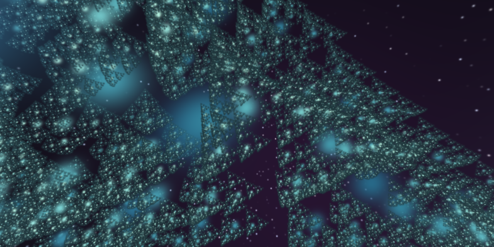
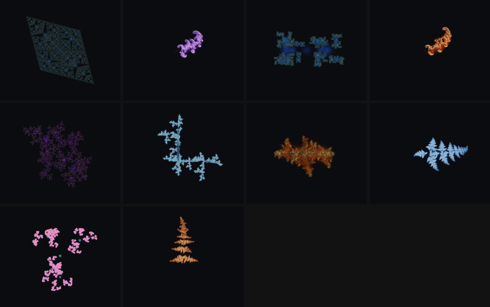
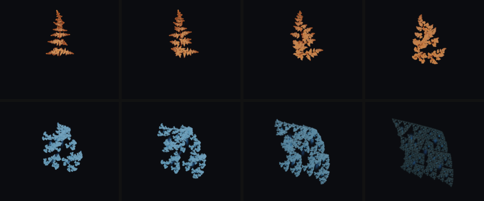
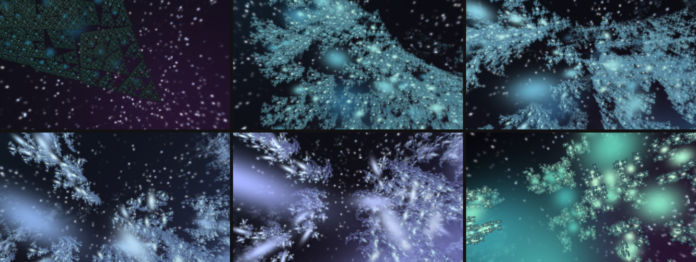

<div align="center">



# ifs-splat

### Fractal worlds as 3-D Gaussian splats — straight from the equations

No scan, no training, no point cloud, no file. An iterated function system *is* the model, and the
splats are generated in draw order, every frame, as far in as you care to fly.

[**▶ Live demo**](https://mikaelcromsjo.com/splat/) &nbsp;·&nbsp;
[What is built](STATUS.md) &nbsp;·&nbsp;
[Design notes](IDEAS.md) &nbsp;·&nbsp;
[Every measurement](MEASURED.md)

</div>

---

## The whole idea, in one line

An affine map of a Gaussian is a Gaussian, in closed form:

```
w(x) = A x + b      ⟹      N(μ, Σ)  ⟶  N(A μ + b,  A Σ Aᵀ)
```

So an IFS acts on *splats* directly. Every node of the recursion carries its accumulated affine
`(A, b)`; its Gaussian is `A·Σ₀·Aᵀ` whenever someone asks. The composed linear part is the
fractal's own Jacobian along that address — which is why the splats stretch along the local branch
direction without anything ever computing a branch direction.

That is the entire representation. There is no geometry stored anywhere: a few dozen numbers
define a world you can fly through for as long as you like.

<div align="center"></div>

<div align="center"><sub>Ten map sets, one engine, no special cases — a tree is four maps with a
trunk mass fraction, a Sierpinski tetrahedron is four maps with that fraction at zero.</sub></div>

## What it does

- **Generates splats in draw order.** No per-frame sort. The expansion emits back-to-front by
  construction, and the error from that approximate order is about a third of the camera's own
  frame-to-frame change, at every percentile including the single worst pixel.
- **Zooms without bottom.** The camera re-roots into whichever node it is inside, so depth is
  unbounded: **depth 52, eleven orders of magnitude**, with a round trip through world
  coordinates exact to one float64 ulp.
- **Adapts its level of detail** to a splat budget and cross-fades what it drops — 25–36 dB
  against a fully expanded ground truth at 2–15× fewer splats.
- **Fills an endless field.** Attractors are placed by hashing where you are, in a hierarchy whose
  cells are provably disjoint: 1.5M pair tests across a 240 s flight, zero intersections, while
  everything drifts, breathes and turns.
- **Morphs while you fly**, along a closed C¹ spline through the map sets, at **the display's
  frame rate** rather than the rebuild rate — the shape between two rebuilds is a lerp done *as
  the traversal reads the table*, which costs +3.8% on the frame.
- **Spends what it saves.** The level of detail is held by a controller that measures the whole
  frame — the walk's own time, the splat ceiling, and the GPU's, from a timer query — so a cheaper
  draw turns into more structure instead of an emptier frame. It charges the splats only for the
  part of the frame that follows the splat count, fitted as `frameMs ~ floor + k·count`, because
  the sky and the pool rebuild cost the same however few splats there are: halving what a splat
  costs then buys **2.00×** the splats. The walk itself splits over four threads at 2.15×,
  splat-for-splat identical to the serial walk.
- **Flies itself** — a slow autopilot that dives along the attractor's boundary rather than into
  its mass, banks into its turns and climbs back out, under a nebula whose stars are band-limited
  the same way the splats are, so nothing crawls when the scale changes by factors of ten.

<div align="center"></div>

<div align="center"><sub>Eight steps along the closed spline through shape space — tree to fern to
sheet, geometry and palette on the same path. In the demo this runs continuously, at the
display's frame rate.</sub></div>

<div align="center"></div>

<div align="center"><sub>Six frames from one 60-second flight, chosen off a contact sheet of the
whole run — the stretches in between are mostly void, which is the fault the autopilot is still
being measured against. Every image here is drawn by a CPU rasteriser, for the reason
below.</sub></div>

## A caveat that belongs near the top

**No GPU code here has ever been executed.** There is no browser on the machine this was built on:
no WebGL run, no screenshot from a real device, no measured frame time. The shaders are checked by
transcribing them to the CPU and comparing against the Python reference, which pins the arithmetic
and says nothing about whether they compile. The compute kernel reproduces the CPU expansion with
**0 wrong draw slots out of 114,687** — a statement about arithmetic, not about drivers.

The throughput work adds to that list rather than shrinking it: `EXT_disjoint_timer_query_webgl2`,
the half-resolution sky's framebuffer and its upsample program, and the ring of upload buffers are
all going out to real drivers unexercised. Each one fails soft — a missing timer query falls back
to a brake on missed frames, a framebuffer that will not complete draws the sky at full
resolution, and `opts.ring: 1` is the old upload path — because the alternative is a black page.
What *is* executed here is everything that can be: the detail controller on synthetic load, both
forms of the projection compared at the last bits, and the threaded walk on real
`worker_threads`.

Everything else in [MEASURED.md](MEASURED.md) was measured headlessly, with a CPU rasteriser that
is a line-by-line twin of the shader.

## Run it

The demo is `web/`: `index.html` plus ES modules. No build step, no server code.

```sh
cd web && python3 -m http.server 8000      # then open http://localhost:8000/
```

**F** switches between the endless field and the single object · **P** opens the proof panel ·
**space** takes the autopilot off · the panel on the right toggles iridescence, rim light, nebula
and stars, and switches the morph and its interpolation on and off while the HUD shows what each
costs: *morph fps* is how often the drawn shape actually changes, *rebuild fps* how often it is
rebuilt. Unticking **interpolate** collapses the first onto the second, which is the judder the
interpolation exists to remove, visible side by side with its own number.

**J** copies a link. Its fragment holds the exact frame of the simulation you are looking at --
the pool, every slot's build parameters, the camera, and the second and a half before you pressed
it -- because a frame number would not: the autopilot integrates real frame times and the dive is
chaotic, so a moment in a browser cannot be re-reached from a number. Send the link and
`node tests/mark.mjs '<link>'` rebuilds that frame offline, checks the reconstruction against what
the page measured, and draws the frames either side of the worst one.

`dist/` is the same demo with the test-only modules stripped, ready to drop on any static host.

The original exporter writes a standard 3DGS `.ply` that SuperSplat, antimatter15/splat,
Nerfstudio or Postshot will open — numpy only:

```sh
python3 ifs_tree_splat.py -o tree.ply -d 7               # 38k splats, the exact attractor
python3 ifs_tree_splat.py -o tree.ply -d 8 -j 0.16       # 153k splats, organic
python3 render_check.py tree.ply check.png               # eyeball it without a viewer
```

## How it is checked

With no browser, every claim has to be made by a program that draws the picture itself:

```sh
cd web
node tests/tour.mjs 150 out/tour.png   # fly the whole demo for 150 s, as a filmstrip
node tests/legible.mjs 120 280 210 1   # is there anything to SEE, or is it a fog bank?
node tests/breath.mjs                  # the morph: C¹, breathing, at display rate, in budget
node tests/toggles.mjs                 # the morph switches, and the rates the panel shows
node tests/secant.mjs                  # what the read-time blend misses, against an exact build
node tests/drift.mjs                   # drawn splat positions against an exact build
node tests/mark.mjs                    # the J-key snapshot: round trip, replay, and the A/B
                                       # that says the live probe can see a known jump
node tests/field.mjs                   # the field: disjoint cells, budget, eviction, motion
node tests/fidelity.mjs                # the level of detail against ground truth
node tests/gpu_transcribe.mjs 7        # the compute kernel against the CPU expansion
node tests/reroot.mjs                  # unbounded zoom, and the round trip through world space
node tests/pilot.mjs                   # what the dive aims at, and what banking does
node tests/space.mjs                   # the sky, and whether its stars crawl
node tests/budget.mjs                  # the detail controller, on synthetic load
node tests/project.mjs                 # the two forms of the shader's projection
node tests/shard.mjs 4                 # the walk split over four real threads,
                                       # compared to the serial walk splat for splat
```

The flight is chaotic by construction — perturb the camera speed by one part in a million and the
heading is 60° away three seconds later — so tests that touch it assert *mechanism*, and the
probes that measure outcome take a seed and are compared in pairs.

## Why it works

Four design points carry the tree:

- **The trunk map is terminal.** It squashes a whole tree copy into one thin rod, so recursing
  into it only re-tiles the same rod. One rod per node is the branch segment — the skeleton's
  geometry, without a skeleton.
- **The trunk map's z factor is exactly `1 − s`**, so a rod's top lands on its children's attach
  height. Branches emerge from the end of the parent segment with no tuning.
- **`Σ₀` is the tree's bounding ellipsoid**, so the trunk map's lateral squash sets the trunk
  radius directly — about 1/37 of height.
- **Branch maps contract uniformly**, giving `Σ → s² R Σ Rᵀ`: elongation rotates onto each
  branch's own axis, so no map is rank-deficient and the degenerate needle covariances of a
  Barnsley-style stem map never appear.

Wood and foliage need no modelling: any address containing the trunk map is wood, pure-branch
addresses are canopy.

> **Watch out for:** the trunk map has to compose in each node's **local** frame
> (`w_path ∘ w_trunk`). Applied to the node's already-placed Gaussian it composes outermost and
> squashes every branch rod back toward the world origin — a floating canopy over a stub. That is
> why the recursion tracks the affine rather than the Gaussian.

## The repository

| | |
|---|---|
| `web/` | the demo — `index.html`, ES modules, and the headless suite that checks it |
| `dist/` | the same demo with test-only modules stripped, for a static host |
| `ifs_tree_splat.py` | the exporter; the IFS is the `BRANCH` / `TRUNK_A` block at the top |
| `render_check.py` | minimal orthographic splat rasteriser (numpy + zlib), writes a PNG |
| `py/` | the offline studies the engine decisions were made from |
| [`STATUS.md`](STATUS.md) | what is built, what is measured, what is not done |
| [`IDEAS.md`](IDEAS.md) | design notes, open questions, and which predictions failed |
| [`MEASURED.md`](MEASURED.md) | every claim, with the test that produced it |
| [`PLAN.md`](PLAN.md) | what it was built against |

## Next

- Turn the dive around where projected detail peaks rather than at `maxDepth` — still the largest
  single win available, and the climb back out is still the worst stretch of the flight.
- Write the WebGPU host code. The kernel and its binding layout exist and are checked against the
  CPU expansion; nothing wires them to a device.
- Adaptive expansion on the GPU: the kernel is uniform-depth, and under an LOD cut you do not know
  a subtree's size until you have walked it.
- The same construction for other IFS attractors. For escape-time fractals (Mandelbulb, quaternion
  Julia) there is no affine structure, so splat covariance has to come from the distance
  estimator's gradient instead.

---

<div align="center"><sub>

Built by measuring. Where a measurement contradicted the plan, the plan is still in
[IDEAS.md](IDEAS.md), with the number that beat it.

</sub></div>
