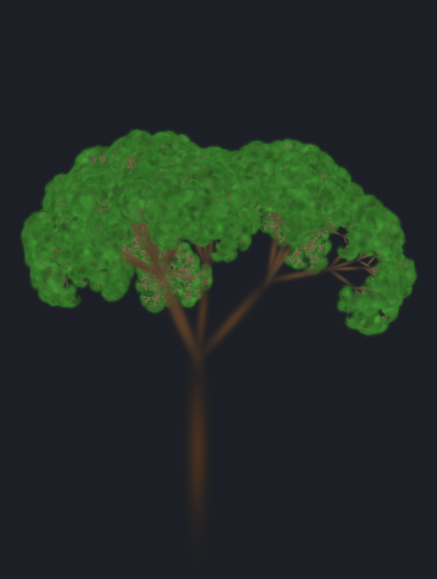

# ifs-splat

Fractal trees as 3D Gaussian splats, generated directly from an IFS — no skeleton, no point
sampling, no training. Output is a standard 3DGS `.ply` that SuperSplat, antimatter15/splat,
Nerfstudio or Postshot will open.

## Run

    python3 ifs_tree_splat.py -o tree.ply -d 7              # 38k splats, the exact attractor
    python3 ifs_tree_splat.py -o tree.ply -d 8 -j 0.16      # 153k splats, organic

    python3 render_check.py tree.ply check.png              # eyeball it without a viewer

numpy only. `-d` is branch recursion depth; splat count is about `5/3 · 4^depth`.
`--up` is the viewer's up-axis (`-y` by default); try `y` or `z` if the tree loads sideways.

## Why it works

An affine map applied to a Gaussian is a Gaussian, in closed form:

    w(x) = A x + b      =>      N(mu, S)  ->  N(A mu + b,  A S A^T)

So the IFS acts on splats directly. Each node of the recursion carries its accumulated affine
`(A, b)`; its Gaussian is `A·SIG0·A^T` on demand. The composed linear part is the fractal's own
Jacobian along that address, which is why the splats stretch along the local branch direction
without anything computing branch directions.

Four design points carry the whole thing:

- **The trunk map is terminal.** It squashes a whole tree copy into one thin rod, so recursing
  into it only re-tiles the same rod (and multiplies the splat count ~250×). One rod per node is
  the branch segment — the skeleton's geometry, without a skeleton.
- **The trunk map's z factor is exactly `1 - s`**, so a rod's top lands on its children's attach
  height. Branches emerge from the end of the parent segment with no tuning.
- **`SIG0` is the tree's bounding ellipsoid**, so the trunk map's lateral squash (0.075) sets the
  trunk radius directly — about 1/37 of height.
- **Branch maps contract uniformly**, giving `S -> s² R S R^T`: elongation rotates onto each
  branch's own axis, so no map is rank-deficient and the degenerate needle covariances that a
  Barnsley-style rank-deficient stem map produces never appear.

Wood and foliage need no modeling: any address containing the trunk map is wood, pure-branch
addresses are the canopy (reshaped into discs, flat along the branch axis).

### Watch out for

The trunk map has to compose in each node's **local** frame (`w_path ∘ w_trunk`). Applying it to
the node's already-placed Gaussian composes it outermost and squashes every branch rod back
toward the world origin — a floating canopy over a stub. That is why the recursion tracks the
affine rather than the Gaussian.

## Files

| | |
|---|---|
| `ifs_tree_splat.py` | the generator; the IFS is the `BRANCH` / `TRUNK_A` block at the top |
| `render_check.py` | minimal orthographic splat rasteriser (numpy + zlib), writes a PNG |
| `preview.png` | `-d 8 -j 0.16 --seed 3` |

`.ply` output is gitignored — it regenerates in a few seconds.

## Possible next

- Export the compact 32-byte `.splat` format (≈1.2 MB at depth 7 vs 2.6 MB ply).
- A WebGL viewer page so it has a URL.
- The same construction for other IFS attractors; for escape-time fractals (Mandelbulb, quaternion
  Julia) there is no affine structure, so splat normals have to come from the distance estimator's
  gradient instead.
